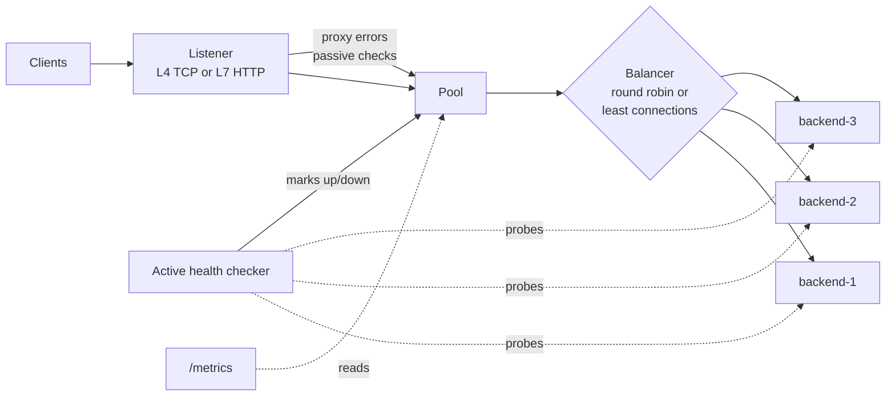

# go-loadbalancer


A layer-4 (TCP) and layer-7 (HTTP) load balancer written in Go using only the standard library. It supports round-robin and least-connections routing, active and passive health checks, graceful shutdown, and Prometheus metrics.

## Why I built it

I wanted to understand what actually happens between a client and a fleet of servers: how a proxy decides where traffic goes, how it notices a server has died, and what changes when you operate on raw TCP bytes versus parsed HTTP requests.

## Architecture



| Package | Responsibility |
|---|---|
| `internal/backend` | One upstream server; health, active-connection count and failure streak are atomics |
| `internal/balancer` | `Balancer` interface plus round-robin and least-connections |
| `internal/pool` | Filters healthy backends, applies passive health checks |
| `internal/health` | Periodic TCP or HTTP probes with healthy/unhealthy thresholds |
| `internal/proxy` | `TCPProxy` (L4) and `HTTPProxy` (L7, built on `httputil.ReverseProxy`) |
| `internal/metrics` | Prometheus text exposition without the client library |

## Quick start

Requires Go 1.22+.

```bash
# terminal 1: three demo backends (the third adds 200ms of latency)
make backends

# terminal 2: the load balancer
make run

# terminal 3
curl -i localhost:8080          # X-Served-By shows which backend answered
curl localhost:9090/metrics
curl localhost:9003/toggle      # make backend-3 fail its health checks and watch the logs
```

Or with Docker: `docker compose up --build`.

To try layer 4 instead: `go run ./cmd/lb -config configs/l4.json`.

## Design decisions

**L4 vs L7.** The TCP proxy pipes bytes and never parses them, so it works for any protocol and is cheap, but it routes once per connection. The HTTP proxy parses each request, so it can route per request, reuse keep-alive connections to backends, and add `X-Forwarded-For`. The cost is parsing overhead and HTTP-only support.

**Half-close in the TCP proxy.** When one side finishes sending, the proxy calls `CloseWrite` instead of closing the whole connection, so a response can still flow back. Closing both directions early is a classic proxy bug that truncates responses.

**Two kinds of health checks.** Active checks probe every backend on an interval and only change state after a streak (`healthy_threshold` / `unhealthy_threshold`) so one slow probe doesn't make a backend flap. Passive checks react to real traffic: consecutive proxy failures take a backend out immediately, without waiting for the next probe. Active checks are what bring it back.

**Client cancellations don't count as backend failures.** If a client disconnects mid-request the backend did nothing wrong, so the L7 proxy records the request as `canceled` and leaves backend health alone.

**Retries.** The L4 proxy retries a failed dial on the next backend inside the same client connection. The L7 proxy does not retry, because replaying a request with a body (a POST, say) can duplicate side effects.

**Lock-free hot path.** Choosing a backend reads only atomics, so concurrent requests never wait on a mutex.

## Benchmarks

`./scripts/bench.sh` starts three backends (two fast, one 200ms slow), runs [hey](https://github.com/rakyll/hey) against each algorithm, and saves the output to `bench-results/`.

<!-- Replace this table with your own numbers after running the script. -->
Three local backends (two with 5 ms of added latency, one with 200 ms), 50 concurrent clients, 20 seconds per run, measured with [hey](https://github.com/rakyll/hey) on a laptop.

| Algorithm | Requests/sec | Average | p50 | p75 | p99 | Share sent to slow backend |
|---|---|---|---|---|---|---|
| round_robin | 658 | 75.5 ms | 9.0 ms | 202 ms | 233 ms | 33.3% |
| least_connections | 2,598 | 19.1 ms | 11.9 ms | 15.5 ms | 209 ms | 2.9% |

Least connections nearly quadruples throughput by starving the slow backend, but p99 barely changes: the requests that still reach it are still slow. Latency-based ejection (taking a backend out when it's slow, not just when it fails) is the next improvement.

What to expect: round robin keeps sending a third of the traffic to the slow backend, so tail latency tracks the slow server. Least connections notices requests piling up there and shifts traffic to the fast backends.

## Testing

```bash
make test   # go test -race ./...
```

Tests cover each algorithm, the health-check thresholds, passive failure detection, L7 routing and headers, and L4 retry on a dead backend. CI runs gofmt, vet and the race detector on every push.

## Roadmap

- Weighted round robin and consistent hashing
- Host and path based routing rules
- TLS termination
- Circuit breaker with half-open probing
- Config hot reload
